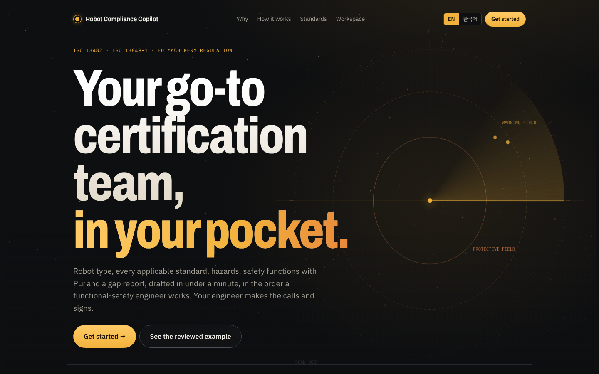
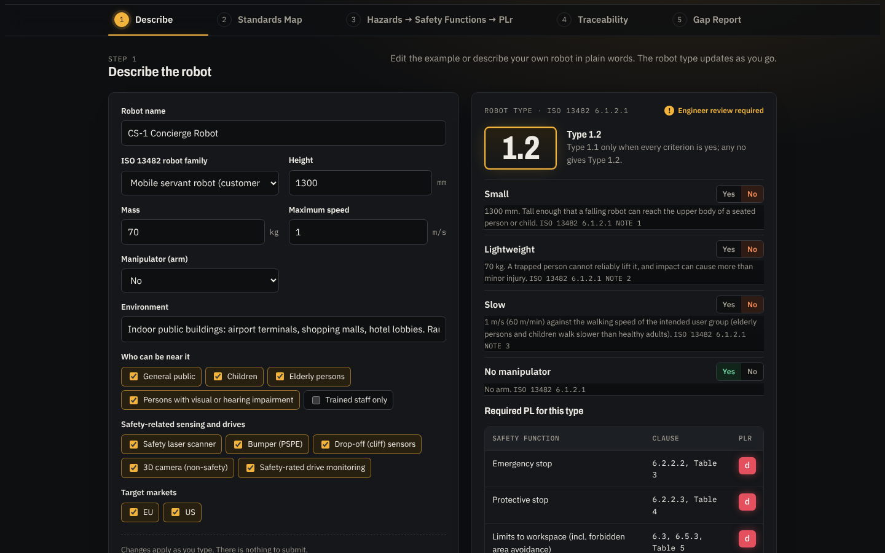
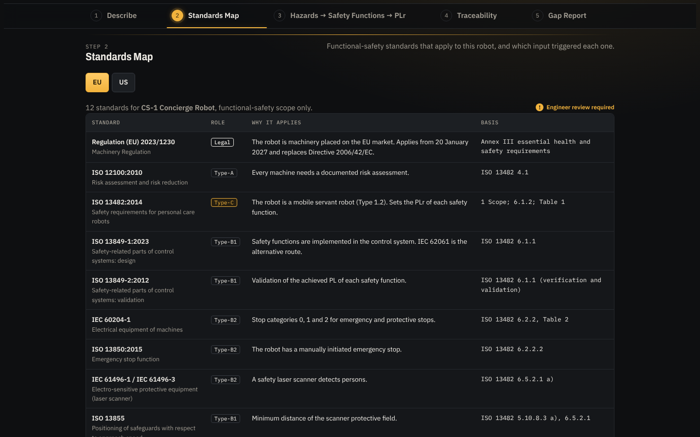
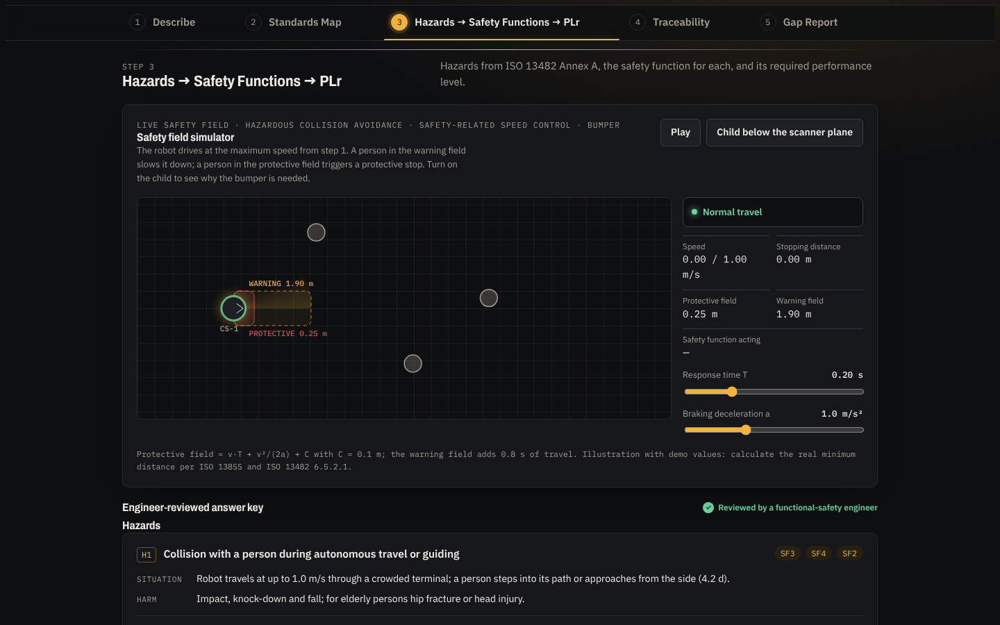
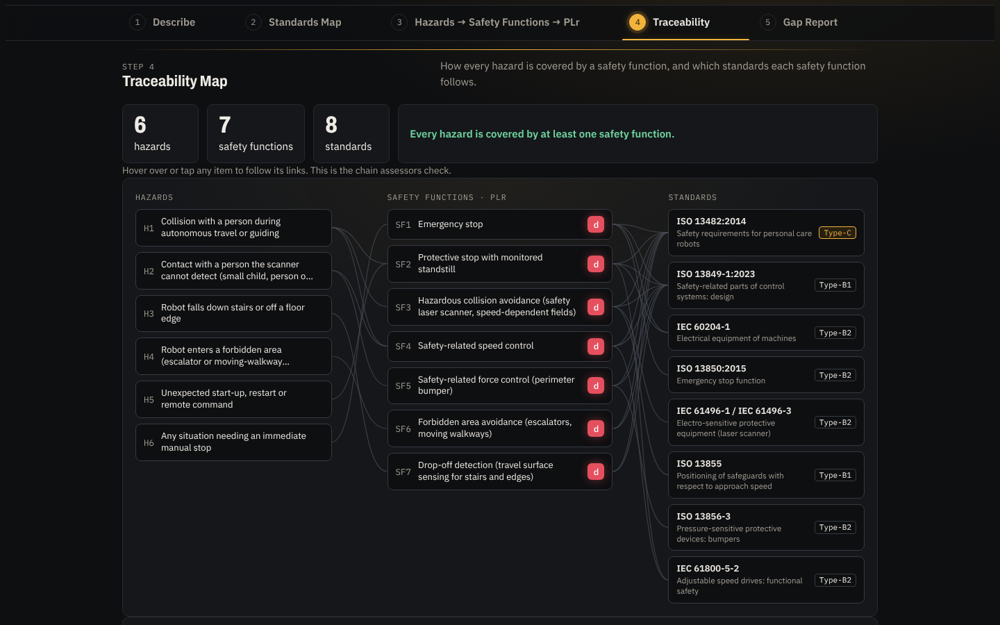
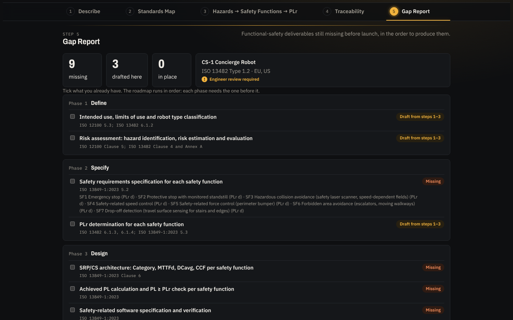
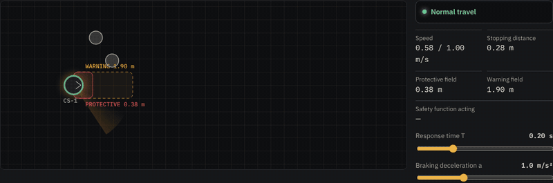
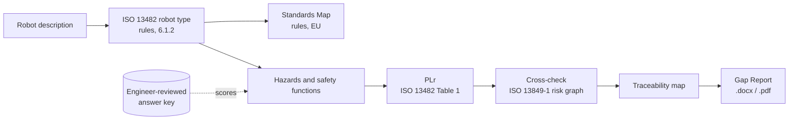

<div align="center">

# Robot Compliance Copilot

**Your go-to certification team, in your pocket.**
A first-draft functional-safety assessment for service robots, in the order a functional-safety engineer works.

[**▶ Try the live demo**](https://eyeon0116.github.io/robot-compliance-copilot/) · [CS-1 answer key](docs/answer-key.md) · [How it works](#how-it-works)

    



</div>

## The problem

Small robot makers ship service robots into airports, malls and hotels, but most of them have no in-house functional-safety team. The first pass of the safety documents (robot type, applicable standards, hazard analysis, safety functions with their required performance level, and what is still missing) usually waits for an outside consultant. In Korea, 65.1% of robot companies earn under ₩1 billion a year (ZDNet Korea, 29 Dec 2025), so that first pass is expensive and slow for most of the industry.

The pressure is about to rise: the EU Machinery Regulation (EU) 2023/1230 applies from **20 January 2027** and replaces the Machinery Directive.

## What it does

Robot Compliance Copilot drafts that first pass in about a minute, in five steps. The engineer reviews every row, makes the calls and signs off. The tool does not certify anything and does not replace a conformity assessment.

| Step | What you get |
| --- | --- |
| **1 Describe** | Robot type per ISO 13482 6.1.2 (e.g. Type 1.2 mobile servant robot), from height, mass, speed, users and sensors. The engineer can override it. |
| **2 Standards Map** | The functional-safety standards that apply for the EU market (12 for the CS-1 example), with the input that triggered each one and its clause basis. |
| **3 Hazards → Safety Functions → PLr** | Hazards mapped to ISO 13482 Annex A, a safety function for each, and its PLr from ISO 13482 Table 1, cross-checked with the ISO 13849-1 risk graph. Includes a live safety-field simulator. |
| **4 Traceability** | How every hazard is covered by a safety function, and which standards each safety function follows. |
| **5 Gap Report** | What is done, what is missing and what the engineer still has to decide, exported as .docx or .pdf. |

<table>
<tr>
<td width="50%"><br><sub><b>1 Describe</b>: robot type classification</sub></td>
<td width="50%"><br><sub><b>2 Standards Map</b>: applicable standards and why</sub></td>
</tr>
<tr>
<td><br><sub><b>3 Hazards → Safety Functions → PLr</b></sub></td>
<td><br><sub><b>4 Traceability</b>: hazard to safety function to standard</sub></td>
</tr>
<tr>
<td><br><sub><b>5 Gap Report</b>: export to .docx or .pdf</sub></td>
<td><br><sub><b>Safety field simulator</b>: warning field slows the robot, protective field stops it, the bumper catches what the scanner cannot see</sub></td>
</tr>
</table>

## How it works



- **Rules first.** Robot type, standards map and PLr lookup are deterministic rules in the browser. PLr follows a fixed precedence: ISO 13482 Table 1 value, then a documented 6.1.4 deviation, then the ISO 13849-1 risk graph for functions Table 1 does not list.
- **Claude for the drafting.** Turning a plain-words description into the form, and drafting hazards and safety functions for a new robot, is where Claude helps. In this public build that option is off; it is planned as a paid option and runs only when the user switches it on.
- **An answer key to measure against.** The bundled example, CS-1 Concierge Robot, is a fictional customer service robot with an engineer-reviewed answer key (6 hazards, 7 safety functions). "Run the test" has Claude draft the analysis from step 1 alone and scores the draft against that key.

### Local mode and privacy

The public demo runs entirely in your browser. Nothing you type leaves the page, no account or API key is involved, and the page is marked `noindex`. For a robot you describe yourself, the robot type and standards map are worked out by rules; hazards, safety functions and PLr are shown for the CS-1 example.

## Scope

- **Functional safety only**, for personal care robots under **ISO 13482:2014**, with a focus on mobile servant robots such as guide, reception and delivery robots.
- **EU market first.** The US mapping is planned for a later release.
- **Out of scope:** battery and charging safety (a separate assessment) and stability control (overturning is handled by inherent design in the example).

## Accuracy so far

In one test on the CS-1 example, a Claude draft written from the step 1 description alone found 7 of 7 safety functions, agreed on 7 of 7 PLr values and added no extra functions, in under a minute.

That is a single robot and a single run. Drafts are matched to the answer key by ISO 13482 Table 1 row, and for a Type 1.2 robot Table 1 gives PL d for every function, so PLr agreement says less than it seems. Broader tests on other robot types come next.

## Run it locally

No install and no build step are needed to use it:

```bash
git clone https://github.com/eyeon0116/robot-compliance-copilot.git
cd robot-compliance-copilot
python3 -m http.server 8000   # then open http://localhost:8000
```

Opening `index.html` directly also works. To rebuild after editing anything in `src/`:

```bash
python3 scripts/build.py           # src/template.html + answer key -> index.html
python3 scripts/answer_key_md.py   # answer key -> docs/answer-key.md
```

## Repository layout

```
.
├── index.html                  # The whole app (generated, single file, no framework)
├── claude-shim.js              # Lets the page run outside claude.ai (local mode, file downloads)
├── src/
│   ├── template.html           # Page source
│   └── customer-service-robot.json  # Engineer-reviewed CS-1 answer key
├── scripts/
│   ├── build.py                # Builds index.html
│   └── answer_key_md.py        # Builds docs/answer-key.md
└── docs/
    ├── answer-key.md           # Readable summary of the CS-1 answer key
    └── screenshots/
```

Hosted on GitHub Pages from the `main` branch root.

## Standards

The tool uses the robot-type PL values of ISO 13482:2014 Table 1 and the ISO 13849-1:2023 risk graph as lookup data, and cites other clauses by number. No standard text is included. ISO standards are © ISO; get the standards themselves from ISO or your national standards body.

## Rights

© 2026 the Robot Compliance Copilot author. All rights reserved. The code is published for hackathon review and is not licensed for reuse.
